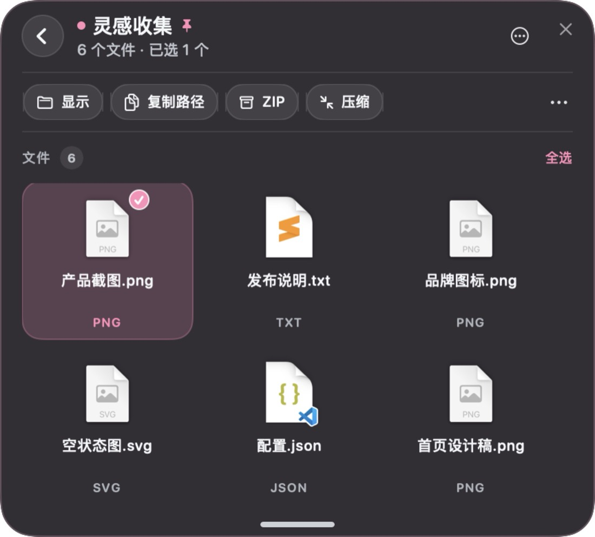
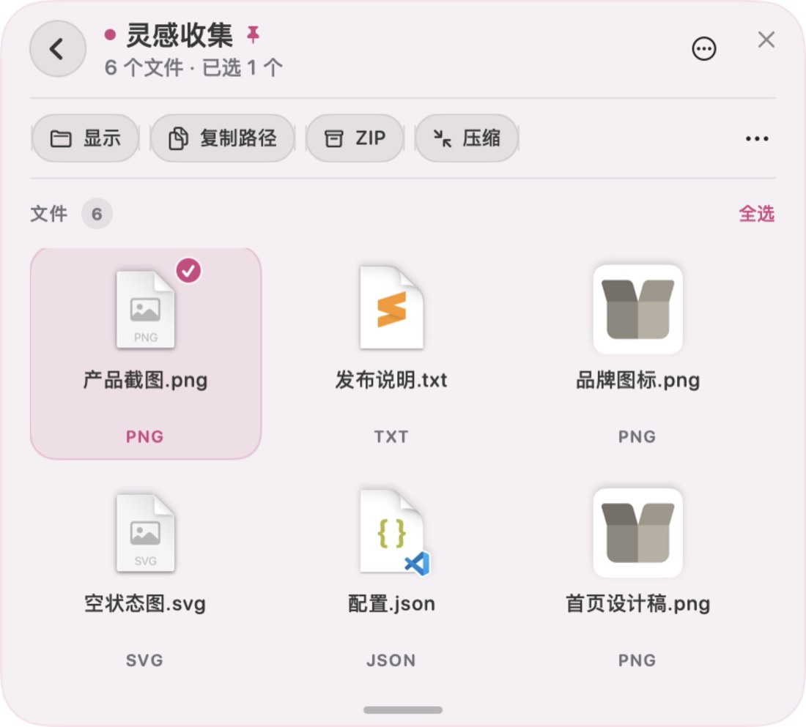

<div align="center">
  
  <h1>DropPoint for macOS</h1>
  <p>用 SwiftUI 与 AppKit 构建的原生 macOS 浮动文件架。</p>
  <p>
    <a href="#安装">安装</a>
    ·
    <a href="#浮动文件架">浮动文件架</a>
    ·
    <a href="#功能">功能</a>
    ·
    <a href="#从源码构建">构建</a>
    ·
    <a href="#作者与致谢">致谢</a>
  </p>
</div>

> [!IMPORTANT]
> 本仓库只包含原生 macOS 实现，不包含 Electron、Node.js、网页前端或跨平台运行时。

DropPoint 2.0 没有工作台，也没有额外的文件管理主窗口。应用只围绕一件事：**在需要的时候出现一个浮动文件架**。

拖动文件时摇晃鼠标，或在拖动中按住修饰键，就能在光标附近生成文件架；把内容暂存其中，切换窗口、桌面或全屏空间后再拖到目的地。也可以从剪贴板、Finder、Dock 图标或菜单栏新建文件架。

文件架默认只保留文件引用。拖入网页图片、生成截图或主动执行复制、压缩、PDF 等操作时会创建本地文件；应用不会把文件上传到自有服务器。

## 浮动文件架

<p align="center">
  
</p>

<p align="center">
  
</p>

<p align="center">
  
</p>

> 截图只记录一帧。猫咪与空箱子播放原始 SVG 的完整形变时间线，由 ImageIO 与 Core Animation 原生播放；减少动态效果开启时使用静帧。

- 紧凑视图显示文件堆叠、文件名或自定义文件架名，并用颜色点标识分类
- 展开视图显示文件网格和快捷操作栏
- 展开宽度固定 432 点，高度按行数 270 / 390 / 436 变化，不裁切快捷栏，也不会留下大块空白
- 通过右上角 `···` 菜单重命名文件架、选择六种颜色或固定文件架
- 双击标题可直接重命名文件架
- 右键文件项目可重命名、上移/下移、用指定应用打开或执行系统分享
- 空格 Quick Look、`⌘W` 关闭、`⇧⌘T` 恢复最近关闭的文件架
- 鼠标按下文件架会激活窗口，空格、Esc、⌘W 等键盘操作始终落在当前文件架
- 从紧凑文件架拖出文件时显示箱子动画和拖出数量，松手后回到文件架
- 同时按下左右 Command，截取光标下最近的窗口并飞入最近的文件架
- 截图前会检查屏幕录制权限；权限不足时显示系统设置引导

## 没有工作台

- 启动后直接显示一个浮动文件架（可在设置中关闭）
- 没有文件架中心或文件管理主窗口
- 程序坞图标存在，但点击它只会显示/新建文件架，不会打开一个空窗口
- 固定文件架与最近关闭保留在菜单栏子菜单中
- 所有文件架都是独立窗口，可以同时打开多个

## 功能

### 文件架交互

- 原生 SwiftUI / AppKit 浮动窗口、菜单栏和系统拖放体验
- 文件、文件夹、Finder 项目及网页图片暂存
- 单文件紧凑视图，以及多文件选择和展开视图
- 空格调用 macOS Quick Look 预览
- 复制、移除、清空、系统分享和在 Finder 中显示
- 拖动文件时摇晃鼠标或按住修饰键快速创建文件架
- 全局快捷键和剪贴板快速创建
- 拖入区域触觉反馈；离开后再次进入会再次反馈
- 放置后自动贴边开关、0–30 秒延迟和左右角落选择
- 双指轻点立即贴边，双指下滑越过阈值后清空文件架
- 监听指定本地文件夹，并独立识别桌面新截图
- 排除应用内部拖出、文件恢复等事件，避免重复创建文件架
- `⌘W` 关闭当前文件架，`⇧⌘T` 恢复最近关闭的内容
- 深色模式、减少动态效果和原生偏好持久化

### 2.0 新增

- **纯文件架应用**：移除了工作台/文件架中心，不再有额外主窗口
- **固定文件架**：为文件架命名、选择颜色并固定；内容持久化到本机，重启后仍可打开
- **最近关闭**：保留最近 12 个关闭的文件架，可从菜单栏恢复
- **颜色标记**：蓝色、紫色、粉色、橙色、绿色、石墨六种文件架颜色
- **快捷操作栏**：展开文件架中显示常用操作，减少右键查找
- **重命名与排序**：直接重命名文件架与文件，按块上移/下移文件顺序
- **打开方式**：从文件架直接选择其他应用打开所选文件
- **多文件打开合并**：一次从 Finder 打开多个文件只创建一个文件架
- **从 Finder / Dock 打开**：把文件交给 DropPoint 即创建文件架
- **双 Command 截图**：同时按下左右 Command，截取最近的窗口并执行飞入文件架的动画
- **屏幕录制权限引导**：截图前检查权限，提供系统设置入口

## 系统要求

- macOS 14 Sonoma 或更高版本
- Apple silicon 或 Intel 64 位 Mac
- Release 构建为 `arm64 + x86_64` Universal App

## 安装

要安装当前验证通过的 **2.0.6**，请检出 [v2.0.6](https://github.com/sanbu3/DropPoint-macOS/tree/v2.0.6)，按[从源码构建](#从源码构建)生成应用。

1. 如需历史版本，前往 [Releases](https://github.com/sanbu3/DropPoint-macOS/releases) 下载对应的 DMG。
2. 打开 DMG，把 `DropPoint.app` 拖入“应用程序”文件夹。
3. 首次启动时，如 macOS 提示来源未验证，请在 Finder 中右键应用并选择“打开”。

当前公开构建使用本地签名，尚未使用 Apple Developer ID 公证。请只从本仓库 Release 页面下载，并按需核对 Release 中公布的 SHA-256；不建议关闭 Gatekeeper。

## 使用方法

1. 启动 DropPoint；如果启用了“启动时新建文件架”，会直接出现一个浮动文件架。
2. 拖动文件时摇晃鼠标，或在拖动中按住修饰键，在光标附近创建文件架。
3. 把文件拖进文件架暂存，切换到目标窗口、桌面或空间后再拖出。
4. 在展开文件架中批量分享、压缩、创建 PDF，或把常用内容固定下来。

常用操作：

| 操作 | 结果 |
| --- | --- |
| `⌘N` | 新建浮动文件架 |
| `⇧⌘S` | 显示/隐藏所有浮动文件架 |
| `⇧Tab` | 默认新建文件架；可在设置切换为显示/隐藏 |
| `⌥⇧A` | 从剪贴板创建文件架 |
| 左右 `⌘` 同时按下 | 截取最近的窗口并飞入文件架 |
| `⇧⌘6` | 通过菜单截取最近窗口 |
| `⇧⌘T` | 恢复最近关闭的文件架 |
| `⌘V` | 把剪贴板中的文件放入当前文件架 |
| `Space` | 预览单文件或展开状态下选中的项目 |
| `⌘R` | 重命名文件架 |
| `⇧⌘P` | 固定 / 取消固定文件架 |
| `⌘⌫` | 清空文件架 |
| `⌘W` | 关闭当前文件架 |
| 双指轻点 | 立即移动到设置的贴边角落 |
| 双指下滑 | 越过触觉阈值后清空当前文件架 |
| 激活文件架后双击 `⌥`，第二次持续按住 | 横条变长、变粗并填充进度，满 1.2 秒清空内容并保留空架 |

清空文件架仅移除架内引用，保留原始文件。Option 长按清空后的空架不会自动关闭，再次放入文件后恢复正常的空架关闭设置。

## 双 Command 截图

把鼠标放在目标窗口附近，同时按下左右 Command：

1. DropPoint 找到光标下最近的窗口或前台窗口
2. 截取窗口内容并保存到本机
3. 添加到你最近使用的文件架；没有文件架时自动在光标附近新建
4. 缩略图从原窗口位置飞入文件架

截图需要 macOS 的“屏幕录制”权限。授权后如果系统要求，重新启动 DropPoint 即可。

## 程序坞与菜单栏

DropPoint 2.0 默认：

- 在程序坞中显示图标
- 启动时新建一个浮动文件架
- 同时保留菜单栏图标，用于新建文件架、打开固定/最近内容和进入设置

可以在 **设置 › 通用** 中关闭启动文件架、关闭程序坞图标或隐藏菜单栏图标。关闭程序坞图标后，应用会退回菜单栏工具模式。点击程序坞图标会显示/新建文件架，而不是打开主窗口。

## 自动收集与截图识别

DropPoint 可以监听用户指定的本地目录，也可以单独识别桌面上的新截图：

- 普通目录监听按设置的文件类别收集新增内容。
- 截图监听仅处理图片，并结合系统截图元数据和常见截图文件名识别。
- 从废纸篓恢复、移走后恢复或重新出现的旧截图不会作为新截图收集。
- 应用内部把文件拖到桌面时，会暂时忽略对应目录变化，避免再次生成文件架。

## 权限与隐私

- “输入监控”用于识别全局文件拖动、修饰键和摇晃手势。
- 文件夹及桌面截图监听只观察用户启用的本地目录。
- 文件内容、缩略图、Quick Look 预览和目录变化均在本机处理。
- 在设置中点击“权限引导”或“启用”后，系统设置旁会出现小型浮窗；把应用图标拖入输入监控列表，再按系统提示打开开关。浮窗会跟随系统设置移动，支持关闭和授权状态刷新。
- 截图需要“屏幕录制”权限；设置页会显示状态，首次截图时会提示授权。
- DropPoint 不需要账户，也不会把文件上传到自有服务器。
- 固定文件架与最近关闭只保存本地文件路径，不复制文件内容。
- AirDrop、信息、邮件等操作由 macOS 系统分享服务处理。

<p align="center">
  
</p>

## 从源码构建

需要 Xcode 以及 [XcodeGen](https://github.com/yonaskolb/XcodeGen)。普通构建与应用运行不需要 Node.js、npm 或 Electron；只有重新生成动画素材时才需要开发用 Playwright 和 Pillow。

```bash
git clone https://github.com/sanbu3/DropPoint-macOS.git
cd DropPoint-macOS
xcodegen generate
xcodebuild \
  -project DropPointNative.xcodeproj \
  -scheme DropPointNative \
  -configuration Release \
  -derivedDataPath .build/Release \
  ARCHS="arm64 x86_64" \
  ONLY_ACTIVE_ARCH=NO \
  build
```

构建产物位于：

```text
.build/Release/Build/Products/Release/DropPoint.app
```

运行测试：

```bash
xcodebuild \
  -project DropPointNative.xcodeproj \
  -scheme DropPointNative \
  -configuration Debug \
  -derivedDataPath .build/Debug \
  test
```

## 版本与验证

当前源码版本为 **2.0.6 / build 15**。更新内容见 [CHANGELOG](CHANGELOG.md)，构建、签名、安装与版本回退规则见[发布检查](docs/release-checklist.md)。

2.0.6 在 macOS 27.3 实机验证了从 Codex 输入框拖入图片、创建和关闭文件架。116 项自动化测试中 115 项通过，1 项因屏幕录制未授权跳过。arm64 和 x86_64 的 Universal Release 构建通过。

## 项目结构

```text
Sources/
├── App/          # 应用生命周期、菜单命令与服务装配
├── AppKit/       # 浮动文件架、拖放、手势与菜单桥接
├── Models/       # 文件架状态、设置、固定/最近内容、命令与颜色
├── Services/     # 快捷键、目录监听、导入、窗口管理与固定内容
├── Utilities/    # 几何、贴边、调色板与视觉辅助
└── Views/        # 文件架与设置界面
Resources/        # 图标、SVG、Info.plist 与文档类型声明
docs/media/       # README 截图、GIF 与视觉验证图
Tests/            # 纯逻辑与交互单元测试
```

## 作者与致谢

本原生 macOS 版本由 **王汪旺**（[@sanbu3](https://github.com/sanbu3)）维护，源码位于 [sanbu3/DropPoint-macOS](https://github.com/sanbu3/DropPoint-macOS)。

核心产品灵感来自 Sudev Suresh Sreedevi（[@GameGodS3](https://github.com/GameGodS3)）创建的 [DropPoint](https://github.com/GameGodS3/DropPoint)，谨此致谢。本仓库为使用 SwiftUI 与 AppKit 完成的独立原生实现。

2.0 的固定文件架、最近关闭、颜色标记与快捷操作栏参考了 [Dropover](https://dropoverapp.com/) 的产品思路，但代码、界面与实现均为本仓库独立完成。

## 开源许可

本项目按 [GNU General Public License v3.0](LICENSE) 发布。你可以在许可证允许的范围内使用、研究、修改和重分发源码；分发修改版或二进制时，须同时履行 GPLv3 对对应源码、许可证文本、版权及修改说明的要求。

本软件按“原样”提供，不附带任何明示或暗示担保。完整条款以 `LICENSE` 为准。

## 贡献

欢迎提交 Issue 或 Pull Request。提交前请确保：

- 修改仅面向原生 macOS 工程，不引入 Electron 或 Node.js 运行时；
- Release 配置能够成功编译；
- 涉及交互时同时考虑键盘、辅助功能和“减少动态效果”；
- 保留 `LICENSE` 及必要的来源说明。
