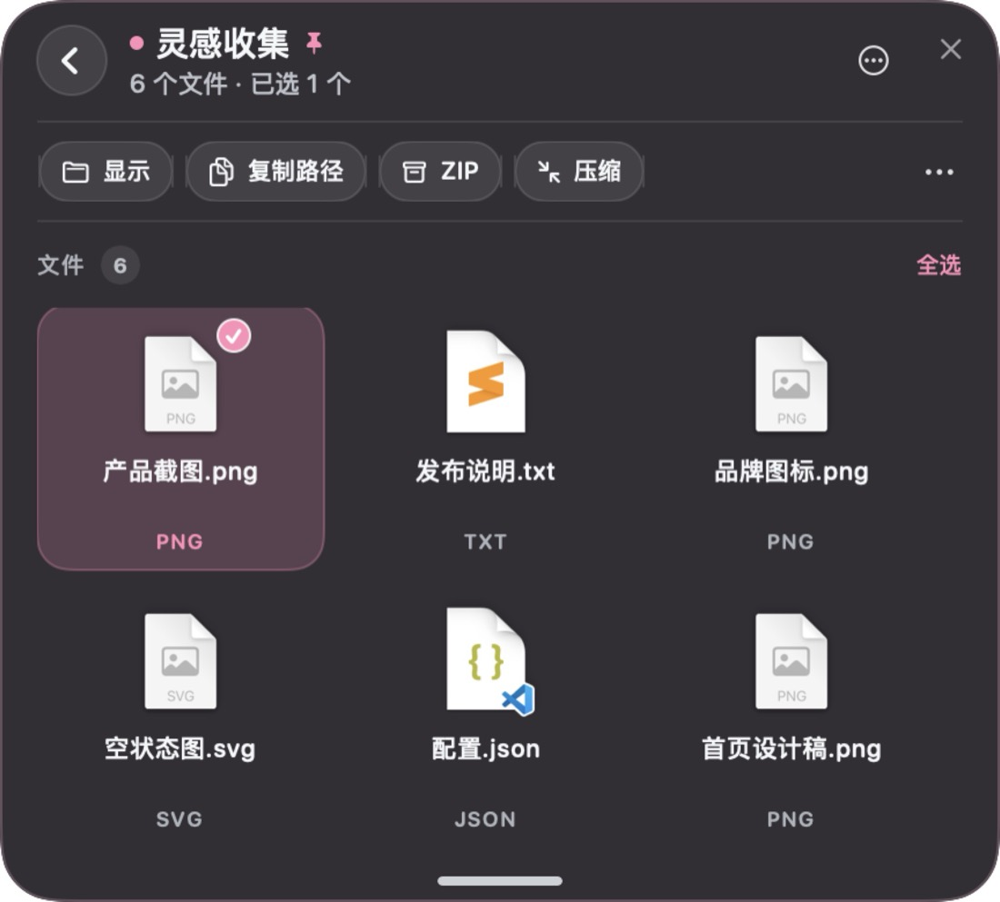
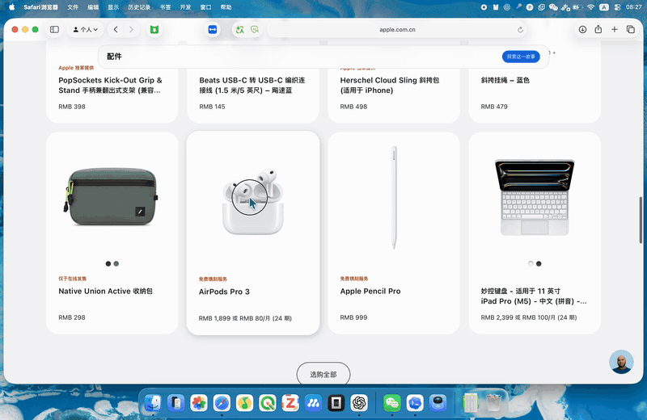
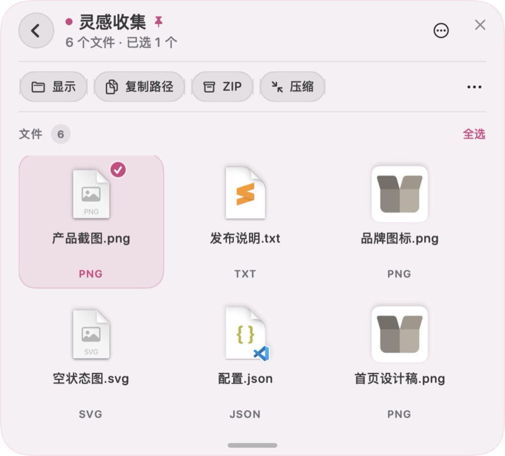
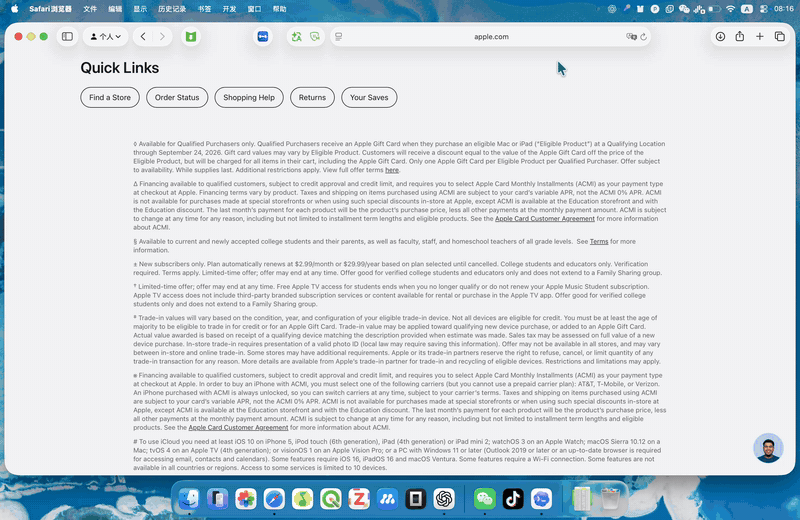
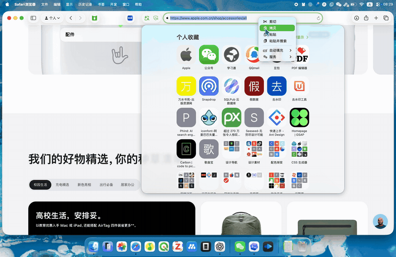

<div align="center">
  
  <h1>DropPoint for macOS</h1>
  <p><strong>先把文件放这儿，等你腾出手再拖走。</strong></p>
  <p>一个免费开源的 macOS 浮动文件架。拖动时晃一晃，手边就多了个放文件的地方。</p>
  <p><code>macOS 14+</code> &nbsp; <code>Apple silicon / Intel</code> &nbsp; <code>SwiftUI + AppKit</code> &nbsp; <code>GPL-3.0</code></p>
  <p><a href="#安装">下载安装</a> · <a href="#文件架的四个状态">界面与动图</a> · <a href="#常用操作">快捷键</a> · <a href="#开发缘起与致谢">开发缘起</a></p>
  
</div>

## 三步就够

1. **叫出文件架。** 拖着文件时晃一下鼠标，或在拖放途中按住设置好的修饰键。也可以用全局快捷键，默认是 `⇧Tab`。
2. **把手里的东西先放下。** 文件、文件夹和浏览器里的图片都可以先放进架子。换窗口、换桌面，或者再去收集几份。
3. **继续拖，或者顺手处理。** 把内容拖到邮件、聊天或另一个 Finder 窗口；也可以展开文件架，直接预览、打包或分享。

例如：从几个目录收齐作业附件，再一次性拖进邮件；从浏览器收集几张图，压到合适的大小再发送。当两个窗口没法并排时，架子就是拖放的中转站。

<details>
<summary>看动图：拖动中唤出文件架</summary>
<br>

</details>

## 文件架的四个状态

| 空架 · 随时接住文件 | 紧凑 · 贴在手边 |
| :---: | :---: |
|  |  |
| 空着时，小猫在纸箱里等你放文件。 | 收起后只占一小块空间，可命名、标色或贴边。 |

| 展开 · 看清每一项 | 拖出 · 一把带走 |
| :---: | :---: |
|  |  |
| 进入文件网格后可以多选，用空格预览。 | 拖出时显示纸箱和数量，方便确认带走了几项。 |

截图来自项目已有的界面记录；早期动图主要演示操作，控件外观可能随版本改变。

<details>
<summary>再看两个场景：剪贴板上架 · 复制与预览</summary>
<br>

**剪贴板上架。** 文件已在剪贴板时，可以直接创建一个架子；也可以选中当前架子，再按 `⌘V` 加进去。



**复制与预览。** 在文件架里确认内容，就可以继续复制或拖到下一处。


</details>

## 值得用在哪儿

| 你正在做的事 | DropPoint 怎么帮你 |
| --- | --- |
| 在多个窗口之间搬文件 | 浮动架子随用随开；支持多个架子、彩色标记、自动贴边，也可以手动隐藏。 |
| 附件很多，想先看一眼 | 展开网格后可多选、用 Quick Look 预览、重命名、排序，或回到 Finder 定位。 |
| 发之前要顺手整理 | 可以压成 ZIP、压缩图片体积、按最长边调整尺寸、把图片合成 PDF，或新建文件夹并移入。也可以用 AirDrop、信息或邮件分享。 |
| 刚拖进来就想处理 | 拖动经过文件架下方的触发点，会展开对应的操作落点。图片可选择压图或调整尺寸，普通文件也能直接进 ZIP 或 AirDrop。 |
| 有几组素材经常用 | 给文件架命名、标色并固定，重启后还能打开；误关时可恢复最近关闭的架子。 |
| 想把截图放到手边 | 同时按下左右 `⌘`，截取光标附近的窗口，截图会飞入最近使用的文件架。也能启用桌面截图或指定目录监听。 |

**没有额外的文件管理主窗口。** 打开后直接用架子，设置和固定项目从菜单栏进入。应用用 SwiftUI 和 AppKit 构建，支持系统浅色、深色和「减少动态效果」，运行不需要 Electron 或 Node.js。

**文件默认留在原位置。** 文件架通常只保留本地文件引用，清空架子不会删除原件。主动选择移动、废纸篓或另存等操作时，才会对文件执行对应处理。导入网页图片和截图时会保存到本机；应用无需账户，也不会把文件上传到自有服务器。系统分享会按你选择的目标发送内容。

## 安装

需要 **macOS 14 或更高版本**。标准 Release 是同时支持 `arm64` 和 `x86_64` 的通用构建。

1. 从 [v2.0.20 发布页](https://github.com/sanbu3/DropPoint-macOS/releases/tag/v2.0.20) 下载 [通用版 ZIP](https://github.com/sanbu3/DropPoint-macOS/releases/download/v2.0.20/DropPoint-2.0.20-macOS-universal.zip)。
2. 解压后，把 `DropPoint.app` 拖进「应用程序」。
3. 当前构建使用 ad-hoc 签名，未经过 Apple 公证。若系统拦下启动，确认来源后，可到「系统设置 → 隐私与安全性」查看能否为该应用单独选择「仍要打开」。

[对应源码](https://github.com/sanbu3/DropPoint-macOS/tree/v2.0.20) · [SHA-256 校验文件](https://github.com/sanbu3/DropPoint-macOS/releases/download/v2.0.20/DropPoint-2.0.20-macOS-universal.zip.sha256) · [全部版本](https://github.com/sanbu3/DropPoint-macOS/releases)

晃动或按修饰键唤出文件架需要**输入监控**。只有在使用窗口截图时才需要**屏幕录制**。安装后也可以先用菜单栏新建文件架并手动拖入文件，再按需开启权限。

<details>
<summary>查看权限引导截图</summary>
<br>

</details>

## 常用操作

| 快捷键 | 操作 |
| --- | --- |
| `⇧Tab` | 默认全局新建文件架；组合键和动作可在设置中修改 |
| `⌘N` / `⇧⌘S` | 在应用内新建 / 显示或隐藏所有文件架 |
| `⌥⇧A` / `⌘V` | 从剪贴板新建 / 粘贴到当前文件架 |
| `Space` | 预览当前文件或所选项目 |
| `⌘R` / `⇧⌘P` | 重命名 / 固定或取消固定 |
| `⌘W` / `⇧⌘T` | 关闭当前文件架 / 恢复最近关闭 |
| 左右 `⌘` 同时按下 | 截取窗口并收进文件架 |

开启对应手势后，双指轻点可贴边，双指下滑可清空。文件架激活时，连按两次 `⌥` 并在第二次按住至进度满，也能清空并保留空架。

## 开发缘起与致谢

我最早是因为看到 [Dropover](https://dropoverapp.com/) 的完整功能需要付费，想给自己做一个免费、开源的文件架：平时收几张图、传几份文件，拖动到一半有地方先放下就够用。做着做着，又加上了我自己常用的截图、压图和批量整理。

早期设计参考了 Sudev Suresh Sreedevi（[@GameGodS3](https://github.com/GameGodS3)）创建的 [DropPoint](https://github.com/GameGodS3/DropPoint)，那是一个基于 **Electron** 的跨平台开源项目，也受到 Dropover 启发。这个仓库由 **王汪旺**（[@sanbu3](https://github.com/sanbu3)）维护，是用 SwiftUI 与 AppKit 编写的独立原生 macOS 实现。感谢原项目作者和贡献者。

## 从源码构建

仓库已包含 Xcode 工程。用 Xcode 打开 `DropPointNative.xcodeproj` 即可构建；修改 `project.yml` 后，用 [XcodeGen](https://github.com/yonaskolb/XcodeGen) 重新生成工程。

```sh
git clone https://github.com/sanbu3/DropPoint-macOS.git
cd DropPoint-macOS
xcodebuild -project DropPointNative.xcodeproj -scheme DropPointNative \
  -configuration Release -derivedDataPath .build/Release \
  ARCHS="arm64 x86_64" ONLY_ACTIVE_ARCH=NO build
```

应用生成在 `.build/Release/Build/Products/Release/DropPoint.app`。版本变化见 [CHANGELOG](CHANGELOG.md)，测试、签名和打包见[发布检查](docs/release-checklist.md)。欢迎在 [Issues](https://github.com/sanbu3/DropPoint-macOS/issues) 报告问题，附上 macOS 版本、DropPoint 版本和复现步骤会更有帮助。

本项目采用 [GNU GPL v3.0](LICENSE)。
